 

Engineering ideas into useful software.
I'm a Practical Software Engineering student at Ariel University, interested in building reliable applications, understanding how systems work, and exploring intelligent automation.

My long-term goal is to turn practical ideas into a technology product of my own.

 

 

 

01 / Selected Work
Projects where I apply what I learn — from full-stack applications to workflow automation.

<table> <tr> <td width="50%" valign="top">

01 — Help Desk
Full-stack ticket management

A support-ticket application with an admin dashboard, ticket tracking, authentication, and database integration.

React TypeScript Express MongoDB

View project ↗

</td> <td width="50%" valign="top">

02 — AI Agent & Automation
Connected workflows

Experiments with AI agents, webhooks, and integrations that automate practical tasks.

n8n AI Agents Webhooks

View project ↗

</td> </tr> <tr> <td width="50%" valign="top">

03 — Node.js Backend
Server-side development

Backend coursework exploring APIs, request handling, and database-connected services.

Node.js Express MongoDB

View project ↗

</td> <td width="50%" valign="top">

04 — React Application
Interactive web interfaces

Frontend coursework using reusable components and application-level interactions.

React JavaScript

View project ↗

</td> </tr> </table>

 

02 / Technical Toolkit

Languages

  

Web development

  

Data & tools

  

  

 

03 / Engineering Foundations
Domain	Focus
Programming	Object-oriented programming, problem-solving
Systems	Operating systems, Linux fundamentals
Networks & security	TCP/IP, ARP, ICMP, Wireshark, security fundamentals
Data	Relational and document databases
Software process	Systems analysis, SDLC concepts
 

04 / Currently Exploring
Java · Data Structures & Algorithms · Software Engineering · Cloud Computing · Software Project Management · API Development

 

05 / Beyond the Code
I want to grow into a developer who can take an idea from problem → design → implementation → real-world value.

For me, learning software engineering is the foundation for a bigger ambition: building and launching a technology venture in the future.

 

LEARN   →   BUILD   →   LAUNCH

Abed Sultan · Software Engineering · Always building, always learning.

 

---

<h2>07 / 🌐 Connect With Me</h2>

  Have an opportunity, an idea, or a project in mind? 
  I'm always open to meaningful conversations and new opportunities.

 

  

<a href="mailto:abed.s.01@icloud.com">
  <strong>abed.s.01@icloud.com</strong>
</a>

  

Open to opportunities · Collaboration · Innovation

<!--
**abeds01-code/abeds01-code** is a ✨ _special_ ✨ repository because its `README.md` (this file) appears on your GitHub profile.

Here are some ideas to get you started:

- 🔭 I’m currently working on ...
- 🌱 I’m currently learning ...
- 👯 I’m looking to collaborate on ...
- 🤔 I’m looking for help with ...
- 💬 Ask me about ...
- 📫 How to reach me: ...
- 😄 Pronouns: ...
- ⚡ Fun fact: ...
-->
